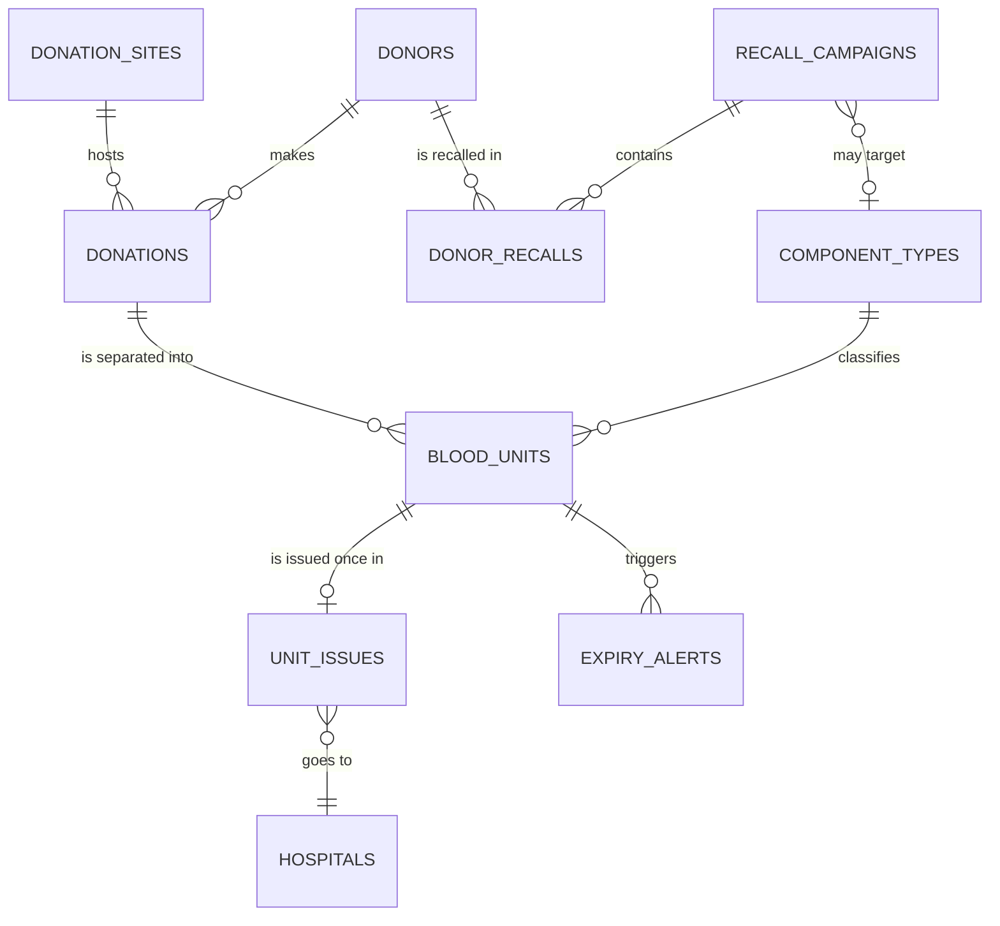

# Data dictionary – logical design (3NF)

Logical design only: Oracle data types and sizes are added in Phase IV.
Diagram: [erd.png](erd.png) (crow's-foot notation). How each table was derived: [normalization.md](normalization.md).

**Key:** PK = primary key · FK = foreign key · UK = unique · Required = must have a value (NOT NULL).

## Relationships

| Parent | Child | Cardinality | Optionality | Meaning |
|---|---|---|---|---|
| DONORS | DONATIONS | 1 : N | A donor may have no donations yet; each donation has exactly one donor | A donor makes donations |
| DONATION_SITES | DONATIONS | 1 : N | A site may have no donations; each donation has exactly one site | A site hosts donations |
| DONATIONS | BLOOD_UNITS | 1 : N | A donation may produce no units (failed screening); each unit comes from exactly one donation | A donation is separated into units |
| COMPONENT_TYPES | BLOOD_UNITS | 1 : N | A component may have no units; each unit has exactly one component | The component sets the unit's shelf life |
| BLOOD_UNITS | UNIT_ISSUES | 1 : 0..1 | A unit is issued at most once; each issue is for exactly one unit | A unit is issued once |
| HOSPITALS | UNIT_ISSUES | 1 : N | A hospital may have no issues; each issue goes to exactly one hospital | A hospital receives units |
| BLOOD_UNITS | EXPIRY_ALERTS | 1 : N | A unit may have no alerts; each alert is for exactly one unit | A near-expiry unit triggers alerts |
| DONORS | DONOR_RECALLS | 1 : N | A donor may never be recalled; each recall entry has exactly one donor | Junction side 1 |
| RECALL_CAMPAIGNS | DONOR_RECALLS | 1 : N | A campaign may have no entries yet; each entry belongs to exactly one campaign | Junction side 2 |
| COMPONENT_TYPES | RECALL_CAMPAIGNS | 1 : N (optional) | A campaign may target no specific component | An urgent recall targets a component |

DONORS ↔ RECALL_CAMPAIGNS is many-to-many and is resolved by the junction table DONOR_RECALLS. HOLIDAYS and AUDIT_LOG stand alone and have no foreign keys.

## Tables

### DONORS – one row per blood donor
| Column | Key | Required | Unique | Meaning |
|---|---|---|---|---|
| donor_id | PK | Yes | Yes | Identifier of the donor |
| source_row_no | UK | No | Yes | Row number in the raw file (1–748); empty for donors registered later |
| status | | Yes | No | ACTIVE or DEFERRED |
| deferral_reason | | No | No | Why the donor was deferred at the last check |
| deferred_until | | No | No | Date from which the donor may give again |

### DONATION_SITES – places where blood is collected
| Column | Key | Required | Unique | Meaning |
|---|---|---|---|---|
| site_id | PK | Yes | Yes | Identifier of the site |
| site_name | UK | Yes | Yes | Name of the centre or mobile unit |
| city | | Yes | No | City of the site |
| site_type | | Yes | No | CENTRE or MOBILE |

### DONATIONS – one row per donation event
| Column | Key | Required | Unique | Meaning |
|---|---|---|---|---|
| donation_id | PK | Yes | Yes | Identifier of the donation |
| donor_id | FK → DONORS | Yes | No | Who donated |
| site_id | FK → DONATION_SITES | Yes | No | Where it was collected |
| donation_date | | Yes | No | Date of the donation |
| volume_cc | | Yes | No | Volume collected in c.c. (250 in the raw data) |
| is_date_estimated | | Yes | No | Y if the date was spaced between the first and last donation, N if taken directly from the raw data |
| screening_result | | Yes | No | PENDING, PASSED or FAILED |

### COMPONENT_TYPES – lookup of blood components
| Column | Key | Required | Unique | Meaning |
|---|---|---|---|---|
| component_code | PK | Yes | Yes | Short code: RBC, PLT, FFP |
| component_name | UK | Yes | Yes | Full name of the component |
| shelf_life_days | | Yes | No | Days a unit of this component stays usable |

### BLOOD_UNITS – one row per component unit made from a donation
| Column | Key | Required | Unique | Meaning |
|---|---|---|---|---|
| unit_id | PK | Yes | Yes | Identifier of the unit |
| donation_id | FK → DONATIONS | Yes | UK with component_code | Donation the unit was made from |
| component_code | FK → COMPONENT_TYPES | Yes | UK with donation_id | Type of component |
| expiry_date | | Yes | No | Last usable date, fixed when the unit is created |
| status | | Yes | No | AVAILABLE, ISSUED, EXPIRED or DISCARDED |

### HOSPITALS – facilities that request blood
| Column | Key | Required | Unique | Meaning |
|---|---|---|---|---|
| hospital_id | PK | Yes | Yes | Identifier of the hospital |
| hospital_name | UK | Yes | Yes | Name of the hospital |
| district | | Yes | No | District where the hospital is located |

### UNIT_ISSUES – a unit leaving the stock for a hospital
| Column | Key | Required | Unique | Meaning |
|---|---|---|---|---|
| issue_id | PK | Yes | Yes | Identifier of the issue |
| unit_id | FK → BLOOD_UNITS | Yes | Yes | Unit that was issued (a unit can be issued only once) |
| hospital_id | FK → HOSPITALS | Yes | No | Hospital that received it |
| issue_date | | Yes | No | Date and time of the issue |
| issued_by | | Yes | No | Staff member (database user) who issued it |

### RECALL_CAMPAIGNS – a round of calling donors back
| Column | Key | Required | Unique | Meaning |
|---|---|---|---|---|
| campaign_id | PK | Yes | Yes | Identifier of the campaign |
| campaign_name | UK | Yes | Yes | For example "March 2007 recall" or a nightly recall list |
| campaign_type | | Yes | No | ROUTINE (nightly job) or URGENT (shortage) |
| start_date | | Yes | No | Date the campaign started |
| component_code | FK → COMPONENT_TYPES | No | No | Component in short supply, for urgent campaigns |

### DONOR_RECALLS – junction: which donor was recalled in which campaign
| Column | Key | Required | Unique | Meaning |
|---|---|---|---|---|
| recall_id | PK | Yes | Yes | Identifier of the recall entry |
| donor_id | FK → DONORS | Yes | UK with campaign_id | Donor being recalled |
| campaign_id | FK → RECALL_CAMPAIGNS | Yes | UK with donor_id | Campaign the entry belongs to |
| return_score | | No | No | Likelihood of return calculated by the system (higher = call first) |
| outcome | | Yes | No | PENDING, DONATED, NOT_DONATED, DECLINED or NO_ANSWER |
| contacted_on | | No | No | Date the recall officer reached the donor |

### EXPIRY_ALERTS – units flagged as expiring soon
| Column | Key | Required | Unique | Meaning |
|---|---|---|---|---|
| alert_id | PK | Yes | Yes | Identifier of the alert |
| unit_id | FK → BLOOD_UNITS | Yes | UK with alert_date | Unit that is close to expiry |
| alert_date | | Yes | UK with unit_id | Date the nightly job raised the alert |
| status | | Yes | No | OPEN or HANDLED |

Days left is not stored: it is `expiry_date − alert_date`, worked out when the alert is shown.

### HOLIDAYS – public holidays for the restriction rule
| Column | Key | Required | Unique | Meaning |
|---|---|---|---|---|
| holiday_date | PK | Yes | Yes | Date of the holiday |
| holiday_name | | Yes | No | Name of the holiday |

### AUDIT_LOG – record of sensitive actions
| Column | Key | Required | Unique | Meaning |
|---|---|---|---|---|
| audit_id | PK | Yes | Yes | Identifier of the log entry |
| table_name | | Yes | No | Table that was changed |
| operation | | Yes | No | INSERT, UPDATE or DELETE |
| record_id | | No | No | Key of the affected row |
| performed_by | | Yes | No | Database user who did it |
| performed_at | | Yes | No | Date and time of the action |
| outcome | | Yes | No | ALLOWED or DENIED |
| message | | No | No | Reason, for example the error raised when an action is blocked |

## ERD source

The image [erd.png](erd.png) is drawn from this Mermaid source. GitHub also renders it below. In the boxes, `req` means required and `opt` means optional.

